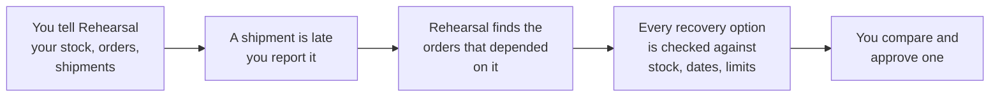

# Rehearsal

**Know what breaks before it does.**

Rehearsal is a web app for people who run a stock-based business (a distributor, a wholesaler, a shop chain). When a supplier says "your delivery will be late", Rehearsal shows **which customer orders are now at risk** and **checks every way out before you act**.

**Try it now (no sign-up):** https://rehearsal-ai-builder-cup-2026.web.app — click **Try the sample**.

Built for the Google AI Builder Cup 2026. It uses Gemini, Cloud Run and Firebase Hosting.

---

## The problem, in a story

Priya runs a drinks distributor. On Wednesday a supplier messages her on WhatsApp:

> "The truck for your 120 cases of mango juice has broken down. New delivery: 22 Oct, 5 pm."

Priya now has to work out, from spreadsheets, chats and memory:

- Which customer orders needed that juice before the 22nd?
- Do I have enough in another warehouse? Can that warehouse even receive more this week?
- Should I buy emergency stock from someone else? Is the price known? Will it arrive in time?

Doing this by hand is slow, and mistakes cost customers. Rehearsal does the checking in seconds, and **shows its working**, so she can decide with confidence.

---

## What you see: a 60-second tour of the sample

The sample is a coffee distributor, **Northstar Supply**. Open it and you land on the Overview:

| Part of the screen | What it says |
|---|---|
| **The delay** | Supplier Meridian Foods' shipment SH-204 (Harbor Blend Coffee) was due Tue 13 Oct and is now due Fri 16 Oct, 3 pm |
| **The impact** | **24 cases exposed**, **3 orders at risk** |
| **Orders at risk** | Common Ground Cafe (priority order) needs 18 cases but only 14 are covered. Harbor Market needs 12 and 0 are covered |
| **Best option** | **Transfer 8 cases from South Hub** for ₹95 (₹55 a trip + ₹5 a case). It fits North Hub's receiving limit of 8 cases per day and arrives before the priority order is due. 16 cases remain exposed |
| **Option waiting for a reply** | **Buy from Supplier B.** Can't be checked yet: stock available, price and arrival time are missing. Rehearsal drafts the message to ask them |
| **Option that can't be done** | **Transfer all 14 cases in one day.** North Hub can receive at most 8 a day, so it would exceed capacity by 6 |

Options are grouped by problem, best first. Each is marked **Ready to use**, **Ready · unverified**, **Waiting for reply**, **Needs your answer**, **Needs information** or **Can't be done**, with the reason in plain words (`statusLabel` in `frontend/src/presentation/planText.ts`). Click **Add details** on a waiting one, type in or upload the supplier's quote, and watch the option become checkable.

---

## How it works



### Four ideas that make it trustworthy

1. **Gemini proposes, the code checks.** Gemini reads documents, suggests spreadsheet columns and answers questions. But the numbers, dates and "is this possible?" decisions come from ordinary, tested code. Gemini can never mark an option as ready on its own.
2. **Missing facts are said out loud.** A location with no stock count counts as 0, and every place that uses it says "no stock count, so it counts as 0" with an **Add count** link. A supplier option with a missing price or date is never guessed: it says exactly what is missing.
3. **Typed-in is not the same as proven.** Anything you type is marked **Unverified**. Attach a photo or PDF (a stock count, a supplier quote) and Gemini reads it, showing the exact words it found. You check each value, and it becomes **Verified**. An option that rests on unverified numbers is shown as *Ready · unverified* and warns you before you approve.
4. **You always check before saving.** Every change is two steps: enter the values, then see what it would change (exposed quantity, orders at risk, which options flip) before confirming.

---

## Try it yourself

### Option 1: the sample (30 seconds)
Open the link, click **Try the sample**. Click around: **Overview**, **Orders**, **Inventory**, **Between locations**, **Suppliers**, **Rehearsals** (the options). Try **Ask AI** ("What should I do first?"). Edit a number and see the plan change. Approve the transfer and watch South Hub's stock go down and the transfer appear under incoming deliveries. **Reset** puts the sample back.

### Option 2: your own business, from a blank page
Click **Sign in with Google**, then **Set up my business**, give it a name and a country (this sets currency, number format and timezone). It is saved to your account, so it opens on any device. Then the **Setup** tab walks you through it, in any order:

1. **Locations**: warehouses, stores, distribution centres.
2. **Products**: what you sell.
3. **Stock counts**: how much is where.
4. **Open orders**: who is waiting for what, and by when.
5. **Incoming shipments**: what suppliers are sending, and when.
6. **Backup sources** (optional): other suppliers and transfer routes you could use.

You don't need everything. Missing facts stay "unknown" and Rehearsal tells you when it matters.

Add things by typing them in, or use **Import file** to load a spreadsheet.

When a shipment is late, click **Report a delay**, pick the shipment and type the new arrival (or upload the supplier's message and let Gemini read the date). The Overview now shows the orders at risk. When the shipment finally arrives, click **Mark resolved**.

### Option 3: ready-made test data (`test-data/`)
Don't want to invent a business? Four independent scenarios are in the [`test-data`](test-data) folder. Each has Excel/CSV files and receipts (supplier quote, delay message, stock count photo, purchase order, transfer booking) you can upload. Each folder has its own `README.txt` with the exact steps. Use any one of them.

| Folder | Country | Good for | Delay to report | What you should see |
|---|---|---|---|---|
| `01-priya-beverages-india` | India | Excel files | SH-7001 to 22/10/2026 17:00 | 60 cases exposed, Spice Route Cafe and Metro Mart at risk |
| `02-brightside-pharmacy-uk` | UK | Unusual column names, dates as text | SH-3301 to 22/10/2026 14:00 | 70 boxes exposed, St Mary's Hospital Pharmacy and HealthFirst Chemists at risk |
| `03-summit-electronics-us` | US | CSV with month/day dates | ASN-4410 to 10/23/2026 13:00 | 75 units exposed, TechNest Austin and Lone Star Office Supply at risk |
| `04-lion-city-foods-singapore-messy` | Singapore | Messy semicolon CSVs and deliberately bad rows | D-501 to 21/10/2026 15:00 | 130 bags exposed, Hawker Centre Co-op and Sunrise Catering at risk |

---

## Worked example: Priya's drinks business (scenario 1)

1. **Set up.** Priya signs in with Google, clicks *Set up my business*, types "Priya Beverages", picks India (₹, day/month dates).
2. **Import.** She imports `1-stock.xlsx`, `2-orders.xlsx` and `3-shipments.xlsx`. Five locations, four products, 16 stock counts, six orders and four shipments appear. Every imported value is labelled **Imported from file**.
3. **Nothing is wrong yet.** The Overview says **"No disruption right now"** and "You're watching 6 open orders".
4. **The WhatsApp message arrives.** She clicks **Report a delay**, picks shipment SH-7001 (Mango Juice 1L, 120 cases) and uploads the screenshot `delay-message-alphonso-agro.png`. Gemini reads **22 Oct 2026, 5:00 pm** and shows the quote it found. She confirms.
5. **See the impact.** Mumbai Warehouse has only 30 cases of mango juice. Two orders need 90 cases before the 22nd (Spice Route Cafe 40, Metro Mart 50). So **60 cases are exposed and 2 orders are at risk.**
6. **Find a way out.** She adds a transfer route from Surat DC to Mumbai Warehouse and uploads the carrier booking (arrives 17 Oct 08:00). She also adds a supplier and uploads the FreshPress quote (150 cases at ₹410, delivery 18 Oct 12:00). Both options are now checked with real numbers and can be compared.
7. **Decide.** She approves one. Approving records it: a transfer takes the stock out of Surat DC now and adds it as an incoming delivery at Mumbai Warehouse; a purchase adds the supplier's delivery.

---

## Importing spreadsheets

You can import **stock counts**, **orders** and **incoming shipments** from `.csv` or `.xlsx` files (up to 20 MB or 100,000 rows). The file is read in your browser and never uploaded.

1. **Choose a file.**
2. **Match columns.** Common names are matched automatically ("Qty", "Quantity", "On hand"...). If your headings are unusual (for example French ones), click **Ask Gemini** and it suggests a match. You can change anything.
3. **Check.** You see what will be added, updated or left out, with the reason and row number for every problem. Nothing is saved until you confirm.

Rules worth knowing:

- A bad row is **left out and listed**, never silently fixed. "twelve" or a blank count is never turned into zero.
- If any row of an order is bad, the **whole order is left out**, so demand is never understated.
- **Importing the same file twice changes nothing** the second time.
- Names are matched ignoring capitals and spacing, so "LION CITY DC" and "lion city dc " are one place.
- Dates follow your country's order (day first for India, month first for the US). A date with no time means the end of that day.
- Several rows with the same order or shipment number become the lines of one order or shipment.

---

## Where your data lives

- **Your own business** needs **Google sign-in** and is saved to **your account in Firestore**, so it opens on any device. Only you can read or change it (enforced by `firestore.rules`). If an older version saved a business in this browser, after signing in you can **Move it to your account** in one click.
- Use the **⋮ menu**: **Download backup**, **Restore from backup**, **Delete this workspace**, **Sign out**.
- The **sample** needs no sign-up and is saved only in this browser. **Reset** only touches the sample.
- Rehearsal's API stores nothing. When you use Ask AI, read a document or use **Ask Gemini** for columns, only what you submit is sent to Gemini to be processed.
- The free Gemini tier lets Google use submitted content. **Use test data only** until a paid tier or Vertex AI is configured.

---

## What is and isn't built

**Works today**
- The sample workflow, Ask AI, document reading with quotes, verified vs unverified values, conflict handling, two-step editing.
- A blank workspace with a guided Setup, empty states, typed-in orders/shipments/suppliers/transfer routes, spreadsheet import, Report a delay, backup/restore.
- Every open order is checked against its warehouse's stock and deliveries due before it, not only orders hit by a delay. Deliveries can repeat (weekly, every 2 weeks, every 4 weeks).
- Recovery options: transfer between locations, buy from a backup supplier, or ship the order from another warehouse (after you say that warehouse can deliver to those customers).
- Costs: transfer routes cost per trip and per package, suppliers have a price per package and a delivery charge, locations have a delivery cost per order. Options are ranked on total cost. A product's optional selling price gives a warning when a fix costs more than the stock it saves is worth. Ready transfers show the latest time to book.
- Storage room per product per warehouse; Rehearsal asks suppliers only for what still fits.
- **Ask your backup suppliers**: a ready-to-send message per problem, with Email all (BCC). Nothing is sent by Rehearsal.
- Orders can be marked delivered (stock goes down), cancelled, or reopened. Suppliers and transfer routes can be edited and removed.
- **Approving records the plan** in the workspace after the server re-checks it: a transfer lowers the source's stock and adds an incoming delivery, a purchase adds the supplier's delivery, ship-from moves the order. Nothing is sent to anyone.
- Money, dates and numbers follow the business's country (India, US, UK, Singapore, Japan, UAE).

**Not built yet (known gaps)**
- **Marking a delivery received.** When an approved transfer or purchase arrives, you must recount the stock and remove the delivery by hand, or it counts twice. There is no way to remove a delivery on screen yet.
- No history of decisions yet; no ready-to-send messages after approval; no choice of goal (options are always ranked to protect deliveries first).
- Voice input. Undo. Several products on one order when typing it by hand (import supports it). Deleting shipments, orders, locations or products. Search and paging outside Inventory.

The full list is in [`docs/TODO.md`](docs/TODO.md).

---

## The Google tools it uses

| Tool | What it does here |
|---|---|
| **Gemini** (`gemini-3.5-flash-lite`) | Reads receipts and messages (photos and PDFs), suggests spreadsheet column matches, answers Ask AI questions. Never decides whether an option is possible. Supplier messages are written by code, not Gemini. |
| **Cloud Run** | Runs the API. Holds the Gemini key (as a secret), re-checks a plan on the server before an approval is recorded, and rate-limits requests (`backend/src/app.ts`). |
| **Firebase Hosting** | Serves the web app and forwards `/api` calls to Cloud Run. |
| **Firebase Authentication** | Google sign-in for your own business. |
| **Firestore** | Saves each signed-in user's business; security rules let only the owner read or change it. |

---

## Run it on your computer

You need Node 20 or newer (the deployed image uses Node 24) and a free Gemini key from [Google AI Studio](https://aistudio.google.com/).

```sh
# terminal 1: the API
cd backend
cp .env.example .env     # then put your GEMINI_API_KEY in .env (never commit it)
npm install
npm run dev              # http://localhost:8080

# terminal 2: the web app
cd frontend
npm install
npm run dev              # http://localhost:5173
```

Without a key the API still starts and the rules engine works, but Ask AI, document reading and **Ask Gemini** for columns will not. Keep the API running even then, because approving a plan is re-checked by it.

**Checks** (the same ones used before every commit):

```sh
cd frontend && npx tsc -b && npx eslint . && npx vitest run && npm run build
cd backend  && npx tsc --noEmit && npx vitest run && npm run build
```

---

## How the code is laid out

```
shared/planner/     The rules engine (plain TypeScript, no libraries). Finds affected orders,
                    checks options, handles unknowns. Used by BOTH the browser and the server.
shared/import/      Which fields a stock/order/shipment file can fill in.
frontend/           React + Vite web app.
  src/components/     Screens: start, setup, operations, planning, editing, import, assistant.
  src/presentation/   Wording and formatting: option labels, supplier messages, Setup steps.
  src/import/         Reads csv/xlsx, matches columns, builds the import preview.
  src/cloud/          Google sign-in and saving your own business to Firestore.
  src/data/           Sample in localStorage, backup and restore, moving an old browser save to your account.
backend/            Node + Express API: Ask AI, document reading, column matching, plan re-check.
test-data/          Four ready-made scenarios with spreadsheets and receipts.
docs/               Product, behaviour rules, architecture, decisions, bug map, backlog.
```

The rules engine is deliberately ordinary tested code. Tests are written from plain rules ("a transfer must fit the receiving limit", "an unreadable count is never zero"), and the [bug map](docs/07-bug-map.md) shows which tests have been seen failing when the rule is deliberately broken, which have not, and which steps are only checked by hand.

## Project docs

- [Hackathon requirements](docs/01-hackathon.md)
- [What Rehearsal is (product)](docs/02-product.md)
- [Behaviour rules](docs/03-behaviour.md)
- [Architecture](docs/04-architecture.md)
- [Scope and decisions](docs/05-scope-and-decisions.md)
- [UX and visual guidelines](docs/06-ux-guidelines.md)
- [Bug map (what protects each risky step)](docs/07-bug-map.md)
- [Progress tracker](docs/Progress.md) and [backlog](docs/TODO.md)
