# 07 — Bug map

Small diagrams of each feature, coloured by **what protects each step**, so weak spots are
easy to see. Updated 2026-10-15 to match the code at commit 25e5e0f.

| Colour | Tag | Meaning |
|---|---|---|
| Green | `[proven]` | A test exists **and** was seen failing against wrong code |
| Blue | `[test]` | A test exists but was never seen failing — it might not catch anything |
| Amber | `[manual]` | Only checked by hand in the browser |
| Red | `[GAP]` | Known missing rule or behaviour, recorded in `TODO.md` |

When a box changes colour, update this file in the same commit.

## Dispatch Review: Small Flows And Connected Map

Requested 2026-10-15 before partial-dispatch implementation. **Current status:** stock ledger, transfer booking/departure, transfer-fate resolution, explicit zero-arrival cancellation, and the order CSV below-sent guard are implemented; C is historical, D-F are current. Remaining gaps include generic customer physical returns and actual customer dispatch/delivery confirmation; repeat-delivery occurrence identity and two-device save conflicts are covered (`occurrenceAt`, `publishCore`). Browser cases/statuses are maintained in `browser-test-matrix.md`.

### A. Planning And Recovery Approval (Current)

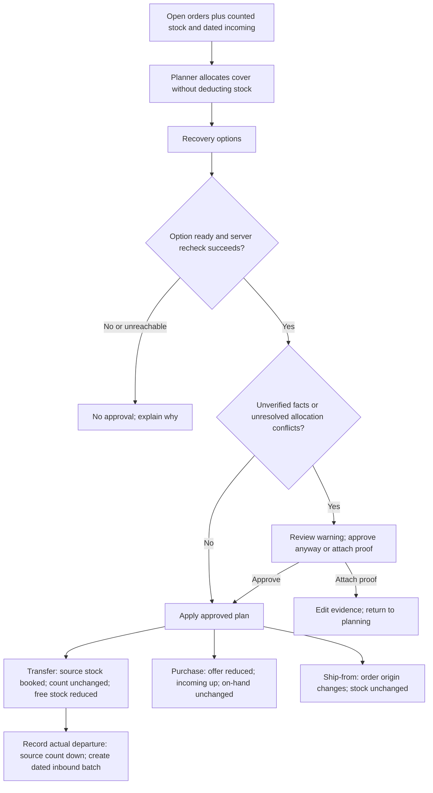

Owners: `allocate`, `rehearse` in `shared/planner/plan.ts`; `requestApproval`, `approve` in `WorkspaceScreen.tsx`; `applyPlan`, `receiveDelivery` and `departTransfer` in `shared/planner/{apply,ledger}.ts`. Inventory subtracts active bookings from free stock but not physical on-hand. Departures create independent inbound shipment batches.

### B. Incoming Receipt (Current)

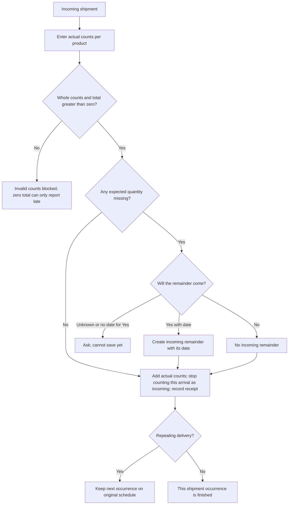

Owners: `ReceiveDialog.tsx`, `receiveDelivery` in `shared/planner/apply.ts`; existing receipt tests in `shared/planner/apply.test.ts`. Over-delivery is allowed: actual received quantities can exceed expected counts. Missing supplier goods do not automatically become cancelled customer demand. Repeating arrivals advance from the confirmed/original schedule, not from actual receipt time; very late actual receipt needs review.

### C. Customer Completion And Reopening (Current)

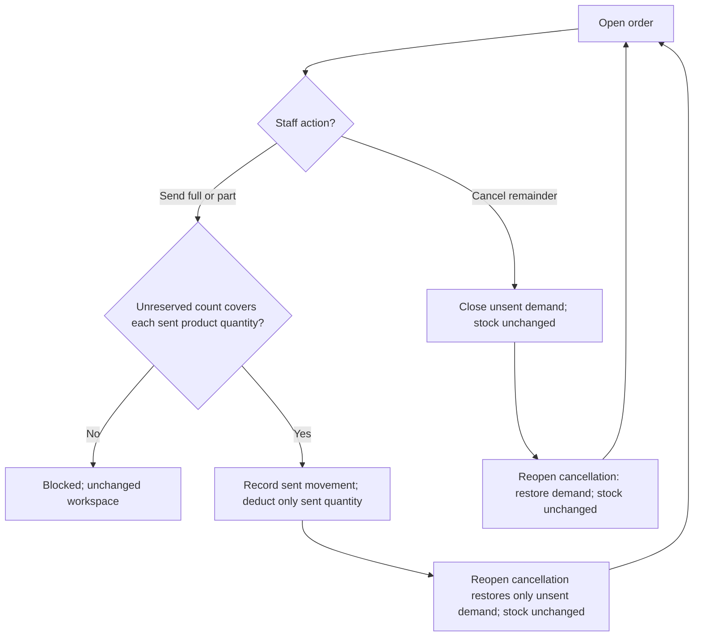

Current owners: `sendOrder`, `cancelRemaining` and `reopenOrder` in `shared/planner/ledger.ts`. Full physical returns remain separate and are not modeled.

### D. Partial Dispatch (Current)

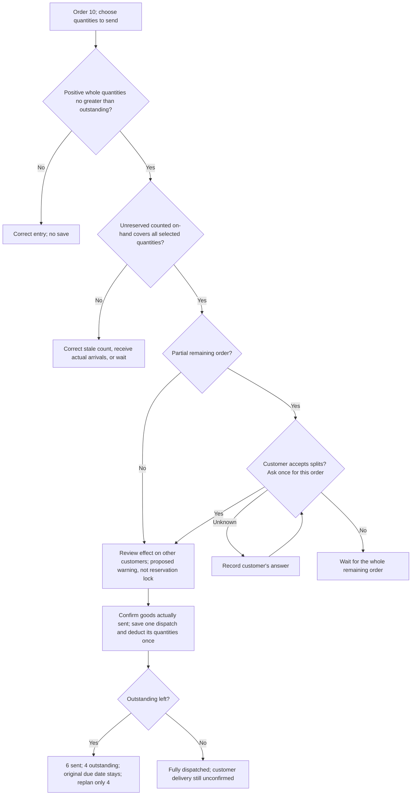

Customer split permission and original remaining deadline are enforced. If a real split already happened despite the saved permission, staff must update the customer's answer before recording; never falsify inventory. Planner allocations are advice, while transfer bookings are explicit source holds.

### E. Correcting One Dispatch (Current)

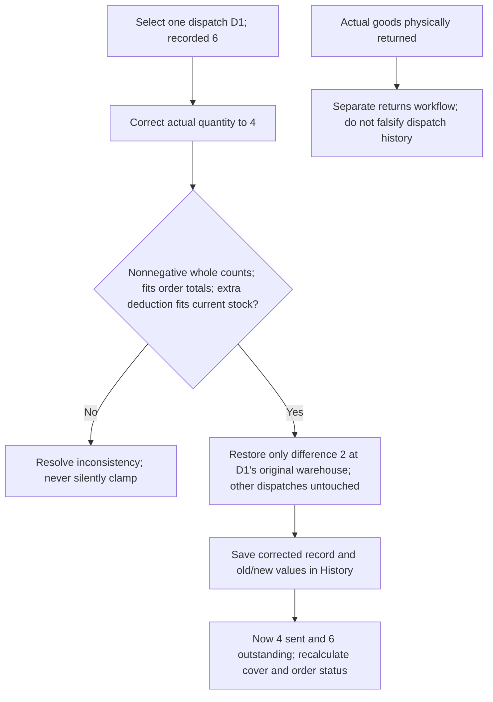

Increasing 6 to 8 deducts only 2 extra. Correcting 6 to 0 restores only that dispatch's 6 and retains the audit record; a correction can be zero even though a new dispatch must be positive. Corrections use current stock, not a historical stock snapshot. Original product/warehouse identity stays on the dispatch. Changing those identities or correcting an already-cancelled order still needs an agreed rule.

### F. Cancelling The Remainder (Current)

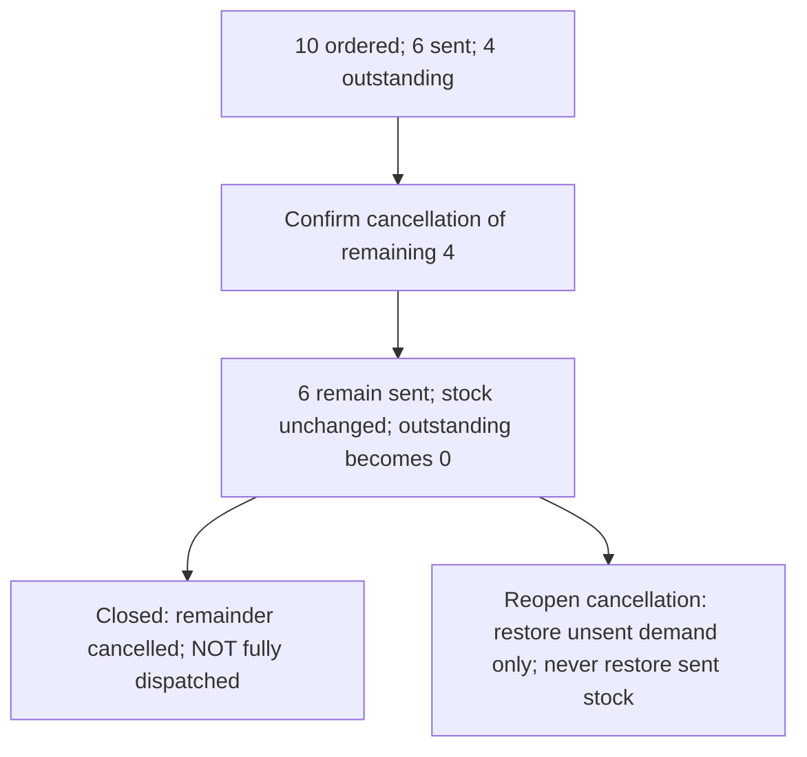

### Connected Overview

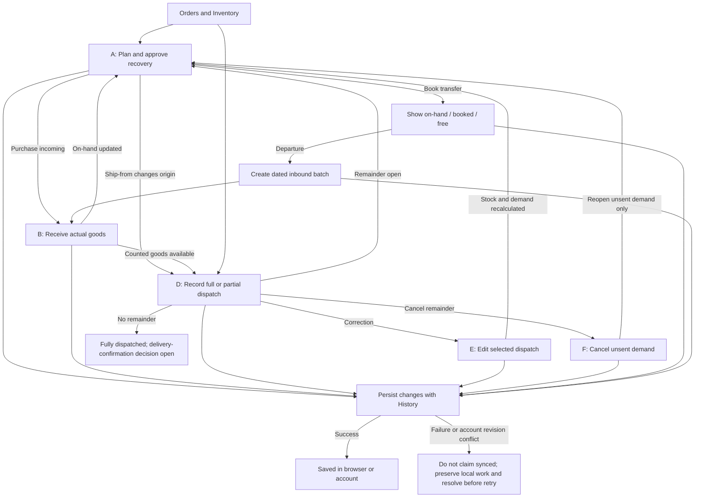

The connected map uses current D-F. C above remains the historical behavior that the movement ledger replaced. The save-failure box is a required handling boundary, not a claim that all persistence failure cases have been tested.

### Branch Audit And Calculation Cases

| Path | Check / finding | Evidence or next action |
|---|---|---|
| A: allocation to dispatch | Coverage is advice, not stock deduction. Do not subtract coverage and sent quantities from stock twice | `allocate`, `outstandingOrders`; `ledger.test.ts` and week simulation |
| A: transfer booking | Approval holds source stock but leaves physical count intact; departure deducts once and creates an ETA-specific inbound batch | `applyPlan`, `departTransfer`, `freeStock`; browser T01-T06 |
| B: full receipt | Add actual count once; remove this occurrence from incoming; keep repeat schedule separately | Existing `apply.test.ts` receipt tests |
| B: partial with Yes / No | 6 of 8 received gives +6 on-hand; Yes keeps 2 incoming at entered date; No keeps no remainder | Existing `apply.test.ts` receipt tests |
| B: zero and never coming | UI blocks zero total and only offers Report late, so it cannot record a fully cancelled arrival through this dialog | `ReceiveDialog.canSave`; missing workflow, not a fixed bug |
| B: late repeating receipt | Receipt timestamp can be after several scheduled dates, but next occurrence advances from old confirmed/original date | `receiveDelivery`; duplicate occurrence/old-date risk needs a worked policy and regression |
| D: insufficient count / repeated product lines | Send checks each product's selected quantity against unreserved counted stock; incoming stock is not dispatchable | `sendOrder`, browser O06 (full quantity refused on count 14) |
| E: correct after recount | Later count already includes actual movement; historical correction changes demand, not current count | `correctMovement`, same-number stocktake control, browser O08 and red/green week simulation |
| D: partial and multi-product | Planner uses remaining quantities per product; fully sent coffee is not demanded again while tea remains | `outstandingOrders`, `plan.ts`, `ledger.test.ts`; browser O05 |
| D: overdue remainder | Past due does not mean fulfilled; outstanding stays demand | `remainingLines`; `overdueOrderIds` shows it as Overdue; browser O11 |
| E: isolated correction | Start stock 12; send 6 -> 6; correct sent to 4 -> 8; send final 6 -> 2. Totals sent 10; remaining 0 | Independent arithmetic example, not a passing-test claim |
| F: cancel after 6 sent | Stock stays at 6; sent remains 6; cancel only 4; no goods return | `cancelRemaining`, `reopenOrder`; browser O09 |
| Save: account write | Changed pieces are written under new content-based ids first; the core manifest is published in one revision-checked transaction. Old pieces are deleted only after publication | `cloudStore.write`, `publishCore`; `chunks.test.ts` |
| Save: two devices at once | Both loaded revision 1; exactly one save wins, the other gets ConflictError and nothing is overwritten | `publishCore`; two emulator tests, observed red with the revision check removed |
| Save: repeat deliveries | Each receipt records its scheduled occurrence | `Movement.occurrenceAt`; `apply.test.ts`, browser R05 |

## 1. Approving a plan
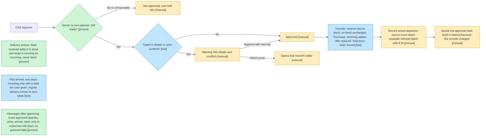
`ap`, `rcv` and `part` are `shared/planner/apply.test.ts`; `keep` is `saveChange` in `frontend/src/WorkspaceScreen.tsx`. `depart` was manually exercised in `browser-test-matrix.md` T03-T06. `rcv` failed (4 tests) when receiving was changed to leave the delivery listed as incoming. `msg` is `frontend/src/presentation/approvalMessages.test.ts`; it failed when notes were sent to covered customers too.

`msg` also protects factual causes: two rule tests failed against the hard-coded late-supplier claim. Plain shortages, unrelated-product delays and arrivals originally scheduled after the customer's deadline cannot be blamed on a relevant supplier delay; all six message tests pass after the fix (`approvalMessages`).

## 2. Adding or editing details
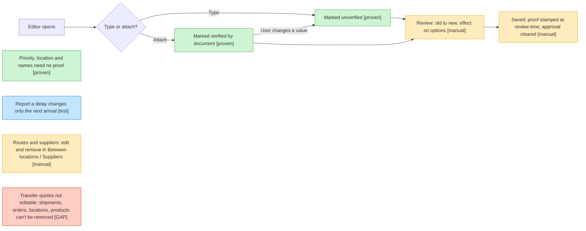
`dl` is `frontend/src/components/editing/recordingEditors.test.ts`.

## 3. Reading a document (API)
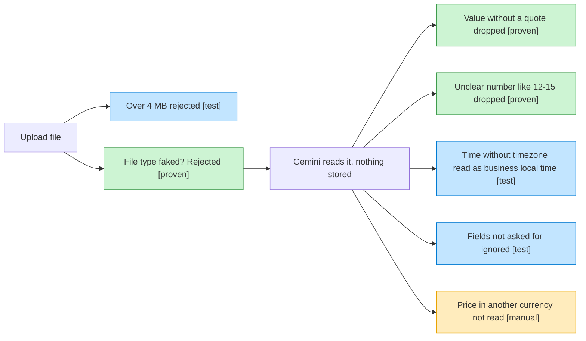

## 4. Planner: affected orders and options
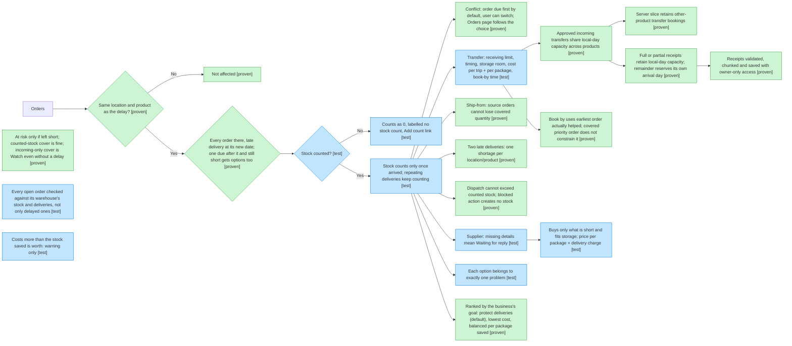
All `[test]` boxes here are in `shared/planner/plan.test.ts`, except `worth` (`frontend/src/presentation/planText.test.ts`). New proven boxes: `booked` and `dispatch` in `shared/planner/apply.test.ts`; `slice` in `shared/planner/blank.test.ts`; `sf` and `once` in `shared/planner/plan.test.ts`. Each was observed failing against the corresponding mistake. The counts-as-0 rule replaced "unknown, not zero" on 2026-10-15 (`docs/03-behaviour.md`); its new test has not been seen failing yet, so it dropped from `[proven]` to `[test]`.

Three-risk follow-up: `received` failed with 6 cases offered after all 8 slots were used; partial receipts check local midnight and the remainder's day (`apply.test.ts`). `risk` failed with no Watch orders for timely incoming cover; `deadline` failed with a rejected useful transfer and an earlier missed standard order's deadline (`plan.test.ts`). `persisted` failed on invalid accepted receipts, unrelated receipt history in slices and oversized core documents (`blank.test.ts`, `frontend/src/cloud/chunks.test.ts`); removing the receipt rule caused permission denied in `frontend/rules-tests/firestore.rules.test.ts`, then all seven passed when restored. Capacity/deadline wording tests in `planText.test.ts` were also observed red. The week simulation now includes received transfer quantities in its daily-capacity invariant.

## 5. Saving and Reset
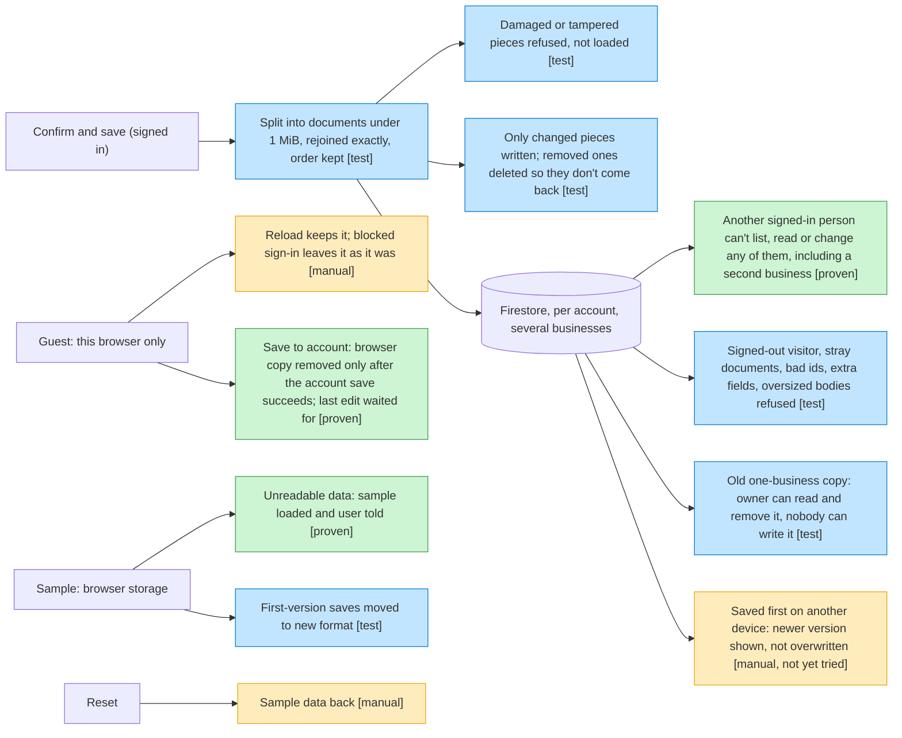
Splitting is `frontend/src/cloud/chunks.test.ts`; the move is `frontend/src/data/moveGuest.test.ts`; the rules boxes are `frontend/rules-tests/firestore.rules.test.ts` (`npm run test:rules`, needs Java 21+). `own` failed on 2026-10-15 when the read rule for a business's data was loosened to "any signed-in person". `mv` failed (3 tests) when the browser copy was cleared before the account save. `keep` was checked in the browser on 2026-10-15. `two` and a real Google sign-in have **not been tried yet**: the built-in browser blocks the Google window.

## 6. Ask AI
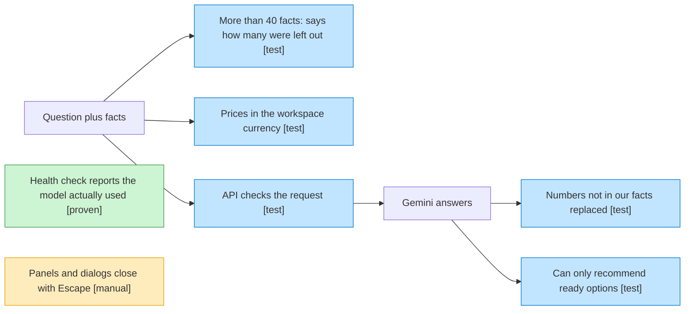

## 7. Importing a file
Where a wrong number could slip in, and what stops it. Every `[test]` is in `frontend/src/import/import.test.ts`, `frontend/src/import/scenarios.test.ts` or `backend/src/importMapping.test.ts`.

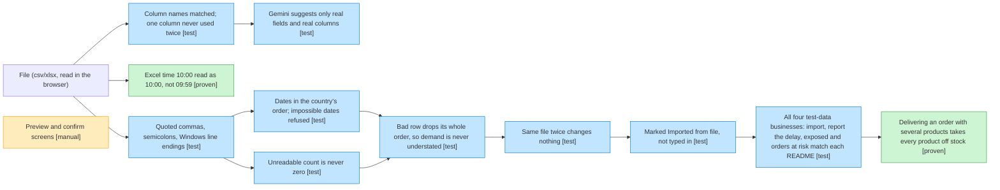
`xt` failed before the fix in `cellText` (`frontend/src/import/table.ts`). `multi` failed when delivery was changed to take only an order's first product off stock; the older single-product tests did not notice.

## 8. Stock ledger (built 2026-10-15)
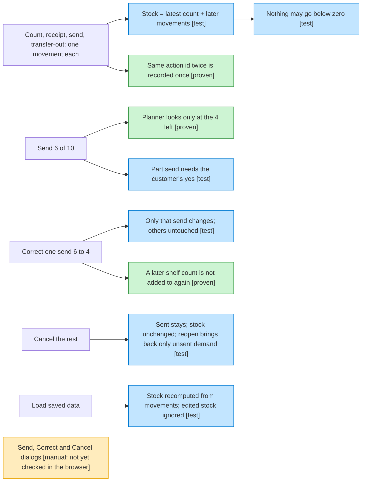
All boxes are `shared/planner/ledger.test.ts`. `plan` failed when the planner was given full order quantities; `recount` failed when a correction was dated when it was entered instead of when the send happened; `once` failed against the first version of `sendOrder`, which checked the remainder before noticing the action was already recorded.

Found and fixed by the week simulation (`frontend/src/simulation/week.test.ts`), each with a red/green test in `ledger.test.ts`: planner functions calling each other subtracted sends twice (Hill Cafe shown covered while 3 short); the server slice treated a partly-sent order moved to another warehouse as fully owed. The simulation keeps its own stock book by plain rules and compares every warehouse, product and order after every step; it failed when corrections were dated at entry time.

### Gaps still open (current code)
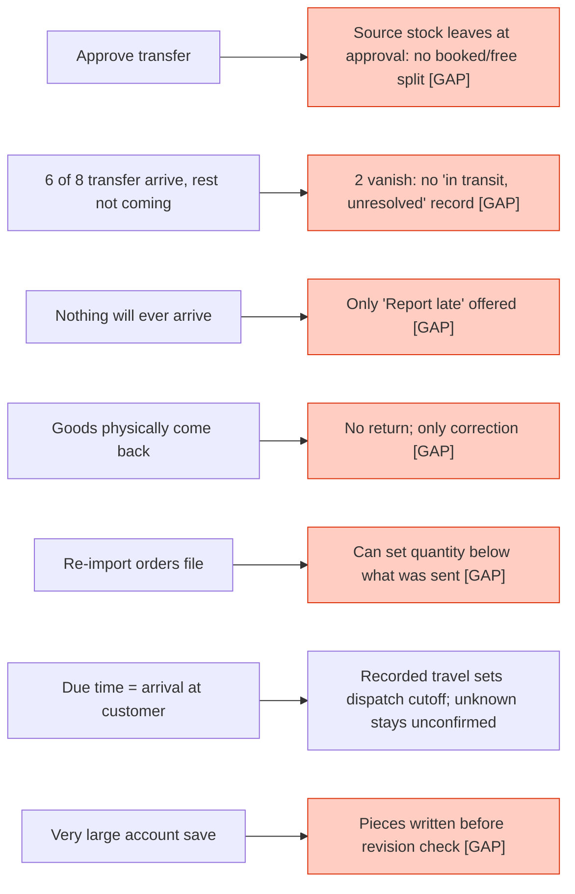
