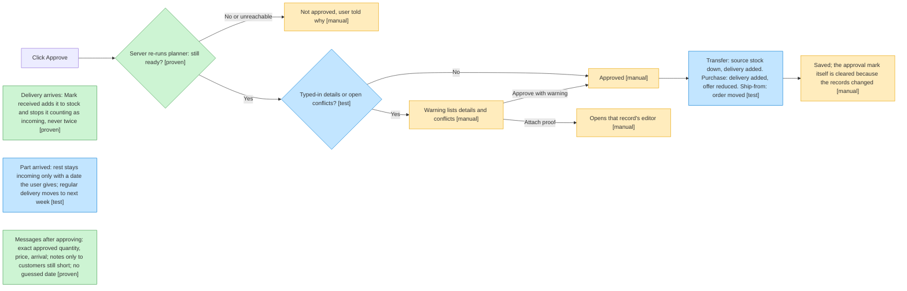
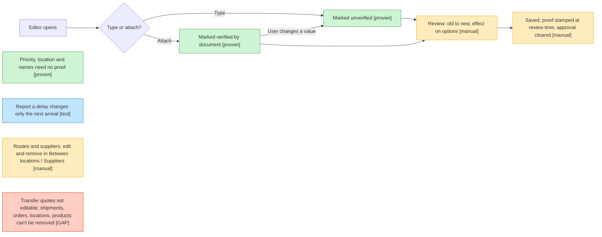
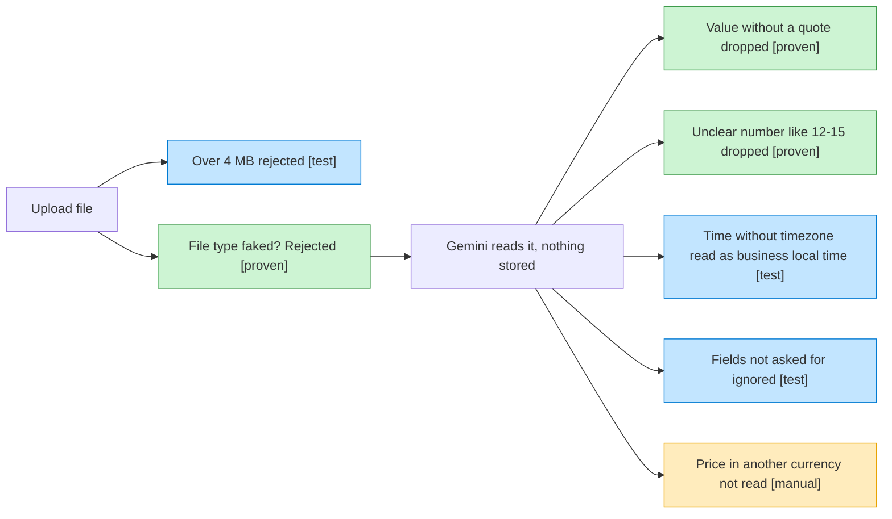
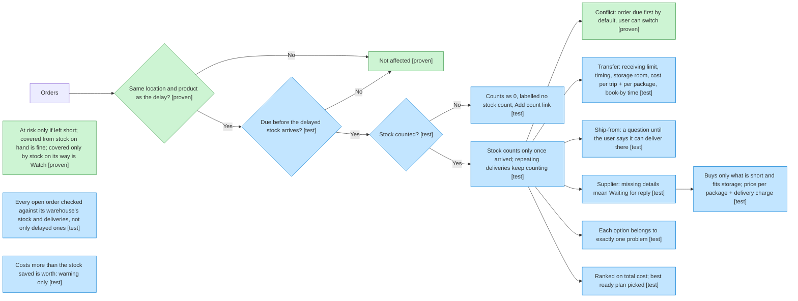
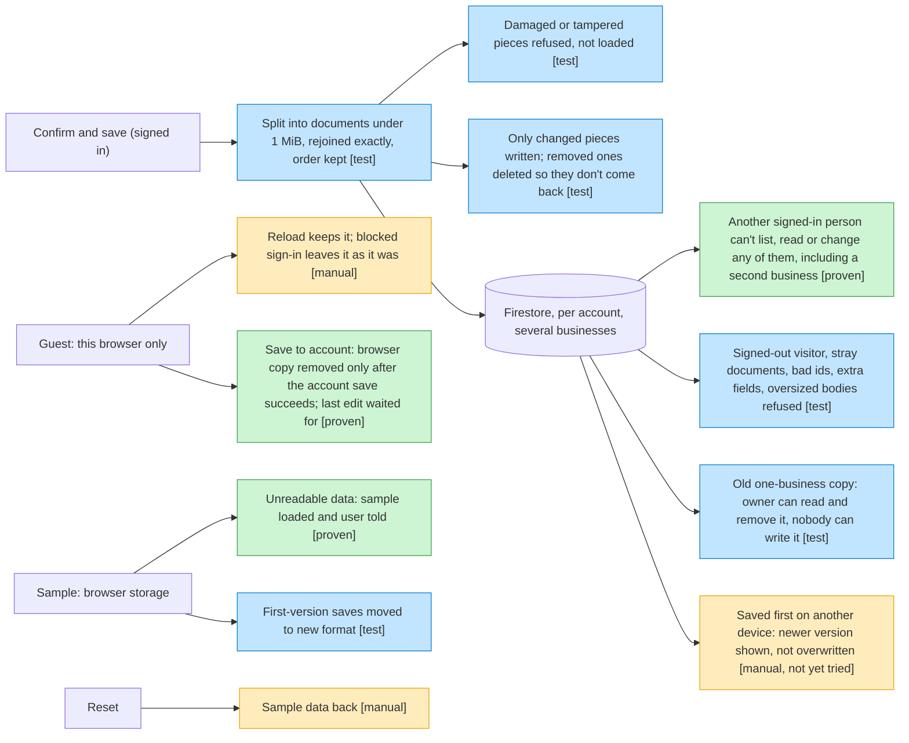
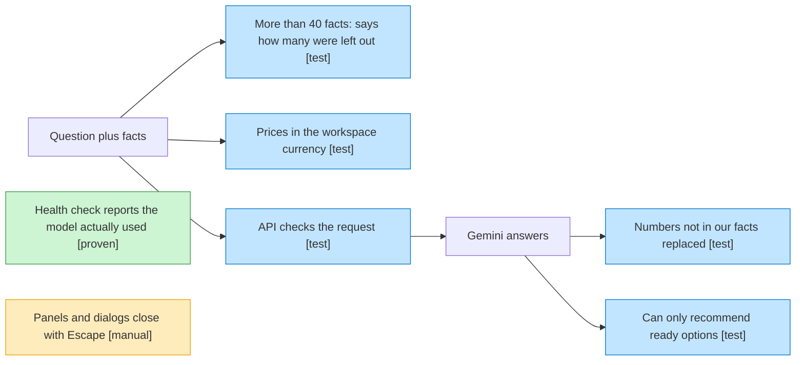
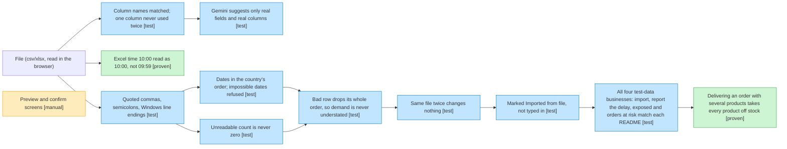

# 07 — Bug map

Small diagrams of each feature, coloured by **what protects each step**, so weak spots are
easy to see. Updated 2026-10-15 to match the code at commit 25e5e0f.

| Colour | Tag | Meaning |
|---|---|---|
| Green | `[proven]` | A test exists **and** was seen failing against wrong code |
| Blue | `[test]` | A test exists but was never seen failing — it might not catch anything |
| Amber | `[manual]` | Only checked by hand in the browser |
| Red | `[GAP]` | Known missing rule or behaviour, recorded in `TODO.md` |

When a box changes colour, update this file in the same commit.

## 1. Approving a plan

`ap`, `rcv` and `part` are `shared/planner/apply.test.ts`; `keep` is `saveChange` in `frontend/src/WorkspaceScreen.tsx`. `rcv` failed (4 tests) when receiving was changed to leave the delivery listed as incoming. `msg` is `frontend/src/presentation/approvalMessages.test.ts`; it failed when notes were sent to covered customers too.

## 2. Adding or editing details

`dl` is `frontend/src/components/editing/recordingEditors.test.ts`.

## 3. Reading a document (API)

## 4. Planner: affected orders and options

All `[test]` boxes here are in `shared/planner/plan.test.ts`, except `worth` (`frontend/src/presentation/planText.test.ts`). The counts-as-0 rule replaced "unknown, not zero" on 2026-10-15 (`docs/03-behaviour.md`); its new test has not been seen failing yet, so it dropped from `[proven]` to `[test]`.

## 5. Saving and Reset

Splitting is `frontend/src/cloud/chunks.test.ts`; the move is `frontend/src/data/moveGuest.test.ts`; the rules boxes are `frontend/rules-tests/firestore.rules.test.ts` (`npm run test:rules`, needs Java 21+). `own` failed on 2026-10-15 when the read rule for a business's data was loosened to "any signed-in person". `mv` failed (3 tests) when the browser copy was cleared before the account save. `keep` was checked in the browser on 2026-10-15. `two` and a real Google sign-in have **not been tried yet**: the built-in browser blocks the Google window.

## 6. Ask AI

## 7. Importing a file
Where a wrong number could slip in, and what stops it. Every `[test]` is in `frontend/src/import/import.test.ts`, `frontend/src/import/scenarios.test.ts` or `backend/src/importMapping.test.ts`.

`xt` failed before the fix in `cellText` (`frontend/src/import/table.ts`). `multi` failed when delivery was changed to take only an order's first product off stock; the older single-product tests did not notice.
